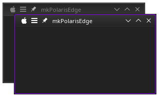

# mkPolarisEdge

A minimalist window decoration for KDE Plasma 6 (KWin), modelled on the look of the
**mkAurorae** themes and built as a native KDecoration3 plugin on top of the Breeze 6.8.1 decoration.

Unlike the Aurorae (SVG/QML) originals, mkPolarisEdge is a compiled C++ plugin, and the grab area
for resizing matches the visible frame exactly.



## Features

- Thin frame and title bar with the geometry of the mkAurorae themes, drawn exactly after their SVG files
- Maximized windows behave as they do in the mkAurorae themes
- **Highlighting of the active window** with a coloured line over the frame:
  - none (active and inactive windows look the same, like the grey mkAurorae theme)
  - the system accent colour
  - purple, red, or any custom colour
- **Bold highlight**: a 2 px line, as in the "B" variants of the mkAurorae themes
- **Corner radius** of the highlight, 0 (square) to 8 px; 4 matches the mkAurorae themes
- Title alignment: left, centre, centre (full width), right
- Optional shadow with adjustable size, strength and colour (off by default, like the originals)
- Settings dialog with English and German translations

## Requirements

- KDE Plasma 6 with KWin and KDecoration3
- Qt ≥ 6.11 and KDE Frameworks ≥ 6.30
- CMake ≥ 3.16, Extra CMake Modules (ECM) and a C++20 compiler

On Arch Linux, for example:

```bash
sudo pacman -S --needed base-devel cmake extra-cmake-modules kdecoration kcmutils kcolorscheme \
    kconfig kconfigwidgets kcoreaddons kguiaddons ki18n kiconthemes kwindowsystem qt6-base qt6-svg
```

Other distributions need the matching `-devel` packages.

## Building and installing

```bash
git clone https://github.com/KrokusPokus/mkPolarisEdge.git
cd mkPolarisEdge
./build.sh       # builds into build-system/ (prefix /usr)
./install.sh     # installs system-wide via sudo
```

`./build.sh --clean` starts again with an empty build directory.

Without the scripts, the manual steps are:

```bash
cmake -S . -B build -DCMAKE_BUILD_TYPE=Release -DCMAKE_INSTALL_PREFIX=/usr -DBUILD_TESTING=OFF
cmake --build build --parallel
sudo cmake --install build
```

### Activating

KWin only loads new decoration plugins when it starts:

- **Wayland:** log out and back in
- **X11:** `kwin_x11 --replace &`

Then select **mkPolarisEdge** under *System Settings → Colors & Themes → Window Decorations*.
The settings are in the edit button on the decoration's preview.

### Uninstalling

```bash
sudo xargs rm < build-system/install_manifest.txt
```

## Development tip

To try a new build without logging out of a Wayland session, start a nested KWin in a window:

```bash
dbus-run-session kwin_wayland --width 1280 --height 800 --xwayland konsole
```

The nested instance loads the installed plugin from disk, and a crash only takes down the test window.

## Translations

Translations live in `po/<language>/mkpolarisedge_kwin_deco.po`. The template
`po/mkpolarisedge_kwin_deco.pot` is generated with `tools/extract-messages.py`.
New languages are welcome as pull requests.

## Credits and licence

- Based on the [Breeze](https://invent.kde.org/plasma/breeze) window decoration by the KDE developers
- Look modelled on the mkAurorae themes

Like Breeze, this project is licensed under
`GPL-2.0-only OR GPL-3.0-only OR LicenseRef-KDE-Accepted-GPL`. Individual files may use other
licences as noted in their SPDX headers; the full texts are in [`LICENSES/`](LICENSES/).
